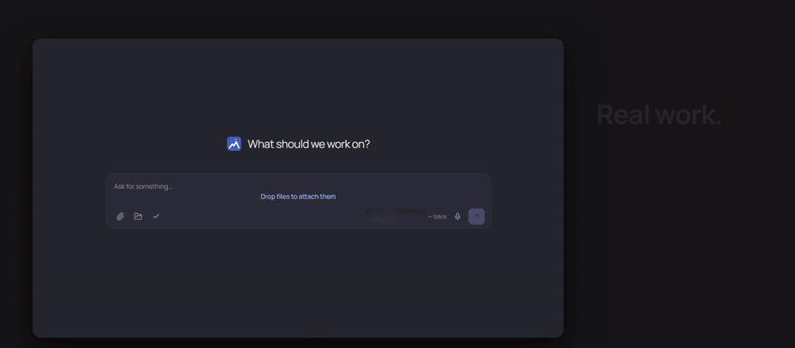
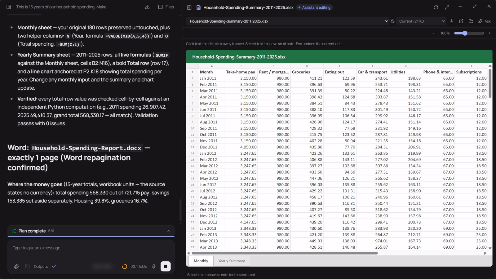
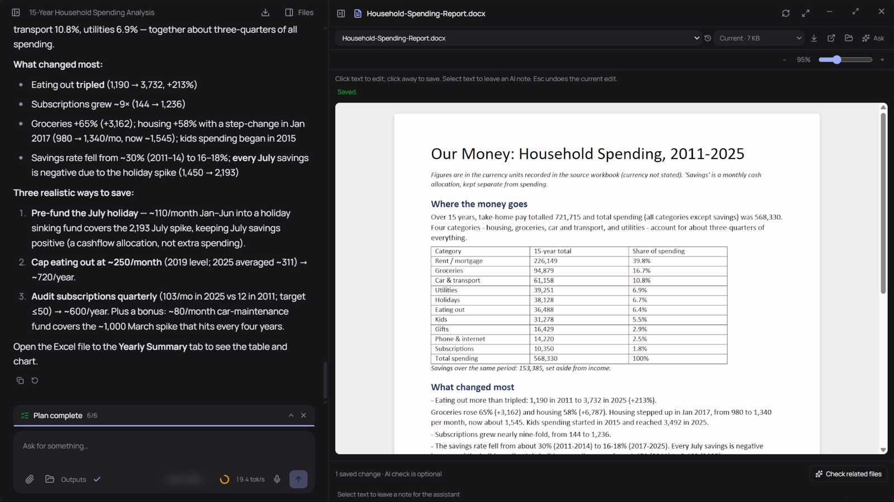
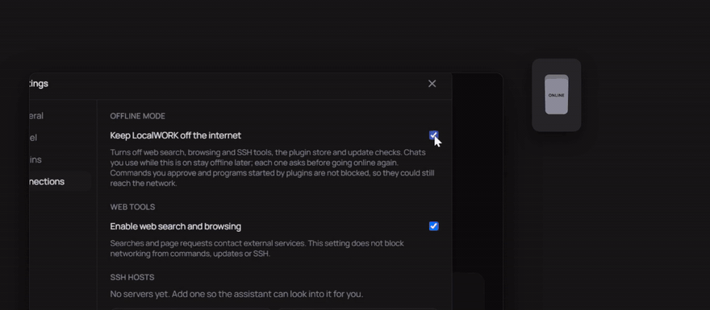
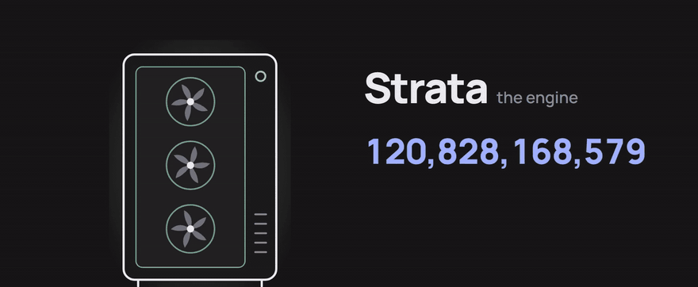

<p align="center">
  
</p>

<h1 align="center">LocalWORK</h1>

<h3 align="center">Your AI. Your PC. Your business.</h3>

<p align="center">
  A Windows desktop assistant that runs on your own computer. It chats, reads your files, and builds real Word, Excel and PowerPoint documents right beside the chat.
</p>

<p align="center">
  <a href="https://github.com/killianmiles27/LocalWORK/releases/latest"></a>
  <a href="LICENSE"></a>
  
  
</p>

<p align="center">
  <a href="#download">Download</a> &middot;
  <a href="#what-it-does">What it does</a> &middot;
  <a href="#what-you-need">What you need</a> &middot;
  <a href="#heads-up">Heads up</a> &middot;
  <a href="#contributing">Contributing</a> &middot;
  <a href="docs/SETUP.md">Setup guide</a> &middot;
  <a href="docs/USAGE.md">Usage guide</a>
</p>

<p align="center">
  
</p>

## So what is this

Say you've got a spreadsheet with fifteen years of your finances in it. Would you upload that to a chatbot? Yeah, me neither. That's why I made LocalWORK.

The model runs on your PC, so your files stay on your PC. There's no account, no subscription, no usage limits and no ads. You hand it a folder or some files, tell it what you want, and it does the work: reading the files, running the numbers, and writing the documents. You watch it happen in a pane next to the chat, and you can click into the result and edit it yourself.

What LocalWORK itself adds:

- **Real Office work.** Word, Excel and PowerPoint files built and edited in place, with previews you can type into, revision history, template matching, and spreadsheet tools that keep track of where the numbers came from. This is the main point of the app.
- **One install, no Docker.** A normal Windows installer. It starts the model for you, waits until it's ready, and unloads it when you're idle.
- **Built for local models.** Local models are slower and make more mistakes than the big cloud ones, so a lot of the work went into keeping long tasks on track: recovering cut-off replies, catching loops, and checking the finished files.

The model side is someone else's work. LocalWORK runs models through [Strata](https://github.com/Niko1221/Strata) by Niko1221 (or [PolyStrata](https://github.com/VecSzn/PolyStrata) for models beyond Qwen). Strata is the reason a model around 125 billion parameters fits on a regular gaming PC at all, so the credit for that goes to them. The Office editing runs on [OfficeCLI](https://github.com/iOfficeAI/OfficeCLI), and the agent is a patched copy of [aionrs](https://github.com/iOfficeAI/aionrs), both by iOfficeAI. For a lot of everyday stuff the result holds its own against the free chatbots you already use. It is not going to beat the big paid ones at everything, and I'm not going to pretend it does.

**Full honesty: this is vibe-coded slop.** I built it with a lot of help from AI, it's still alpha, and there are bugs, especially on long tasks. Check what it makes before you rely on it. If something breaks, please [open an issue](https://github.com/killianmiles27/LocalWORK/issues). If you want to fix it yourself, pull requests are very welcome.

## Download

Grab `LocalWORK_<version>_x64-setup.exe` from the [latest release](https://github.com/killianmiles27/LocalWORK/releases/latest) and run it.

The installer has the app and its tools. It does **not** include a model. The first-run wizard asks if you already have one, and if you don't, it walks you through installing Strata with a command picked for your graphics card. Model downloads are big, so that part takes a while.

Updates are signed. You can check for them in Settings > App, or turn on automatic updates there (it's off by default).

## What it does

<table>
<tr>
<td width="50%" valign="top">

### Everyday stuff

Homework, emails, quick questions, charts, maps, voice typing. The normal things you'd use a chatbot for.

</td>
<td width="50%" valign="top">

### Real work

Hand it your files and it builds real `.docx`, `.xlsx` and `.pptx` files with live formulas, charts and tables. They open in the side pane, and you can click any text to edit it.

</td>
</tr>
<tr>
<td width="50%" valign="top">

</td>
<td width="50%" valign="top">

</td>
</tr>
</table>

<p align="center">
  
  <br>
  <sub>Edit the document yourself. Saving doesn't start the AI. When you're done, click Check related files and it updates anything that depends on your change.</sub>
</p>

<table>
<tr>
<td width="50%" valign="top">

### Off the internet when you want

Model inference is always local. Flip on offline mode and LocalWORK keeps itself off the internet: no web search, no browsing, no update checks. Turn it back off when you need the web tools.

The optional electricity cost plugin shows what a task cost you in power, which is the only meter running.

</td>
<td width="50%" valign="top">

</td>
</tr>
<tr>
<td width="50%" valign="top">

</td>
<td width="50%" valign="top">

### Fast enough to actually use

With Strata on a decent graphics card, replies come out faster than you can read them. Speed depends a lot on your hardware and the model you pick.

</td>
</tr>
</table>

### The full list

- Chats tied to a working folder, with attachments and saved history. Searchable sidebar grouped by date, with pin and rename. Edit an earlier message or regenerate the last reply.
- Word, Excel and PowerPoint files through OfficeCLI, with editable previews, zoom, revision history, and an optional Check related files button after you edit.
- Spreadsheet work that doesn't just dump every cell into the model: compact profiles, reusable aggregates, and checks against the evaluated values.
- Bring a company template or an example document and the results come back in that format.
- Web search, page reading, browser interaction and screenshots (these need the internet).
- Tables, charts, diagrams and small interactive HTML pages.
- Local voice typing through whisper.cpp.
- Optional SSH access to servers you add yourself.
- A live plan panel, a context ring with automatic compaction, recovery from cut-off replies, and a Stop button. You can keep typing while it works and your message waits its turn.
- Markdown chat export, including the thinking and per-request timing.
- Plugins for modes, skills, status readouts and tools. Get them in Settings > Plugins > Get plugins, which lists the [official plugins](https://github.com/killianmiles27/LocalWORK-plugins) (a CPU/GPU bar and the electricity cost per task) and any GitHub plugin repo you add.

## What you need

- Windows 10 or 11, 64-bit. macOS and Linux aren't built or tested.
- For the recommended Strata setup: a regular gaming PC with a 12 GB+ graphics card and 32 GB of RAM, plus plenty of disk space for the model.
- Or any OpenAI-compatible server already running on your PC, like LM Studio or Ollama. In that case your hardware needs are whatever that model needs.
- Internet for the first install and model download. After that the model and file work run locally. Web tools still need the network.

The [setup guide](docs/SETUP.md) covers all of this in detail, including building from source. The [usage guide](docs/USAGE.md) covers the app itself.

## Heads up

Automatic mode is on by default so normal work doesn't ask you for permission every five seconds. It still asks before things it recognizes as destructive, but that check is a heuristic. **It is not a sandbox.** Tools run with your Windows user's permissions. Give it a separate working folder, keep backups, and use a VM or a separate account for anything you don't trust.

Chats and browser profiles are stored locally and LocalWORK doesn't encrypt them. Office previews are close but not exact, and Word page counts need Word installed. Long tasks can repeat steps or lose details when the context gets compacted. There's no guarantee a task finishes correctly, so check the output.

See [SECURITY.md](SECURITY.md) for the full list of boundaries and how to report a security problem privately.

## Contributing

I'm open to contributions and bug reports, seriously. This is one person plus a lot of AI, so there's plenty to fix.

- **Found a bug?** [Open an issue](https://github.com/killianmiles27/LocalWORK/issues) with what you did, what you expected, and what happened. Your model and graphics card help too. A chat export (the download button in the chat header) helps a lot, but read it first and remove anything private.
- **Want to fix something?** Small, focused pull requests are easiest to review. Read [CONTRIBUTING.md](CONTRIBUTING.md) for the test commands. Most unit tests don't need a model.
- **Want to make a plugin?** See [docs/PLUGINS.md](docs/PLUGINS.md).

The frontend is React and TypeScript, the host is Rust on Tauri 2, and the workbench tools are Python. To work on it:

```powershell
git clone https://github.com/killianmiles27/LocalWORK.git
cd LocalWORK
npm ci
npm run tauri -- dev
```

That needs the pinned runtime tools first. [docs/SETUP.md](docs/SETUP.md#build-from-source) has the full steps. Before opening a pull request, run `npm run build`, `npm run test:workspace` and `cargo test --locked --lib --manifest-path src-tauri/Cargo.toml`.

## Credits

Some safety and reliability ideas (always-ask command categories, exact-command approvals, the stall notice, structured tool refusals, preflight checks and queue reordering) were adapted from [Eigent](https://github.com/eigent-ai/eigent) (Apache-2.0). No Eigent code was copied. See [NOTICE.md](NOTICE.md) for the other projects LocalWORK builds on.

## License

LocalWORK is [Apache-2.0](LICENSE). Dependencies, bundled tools, fonts and model weights keep their own licenses. See [NOTICE.md](NOTICE.md) and [third-party](third-party/). The app doesn't give you any rights to third-party models or trademarks.
